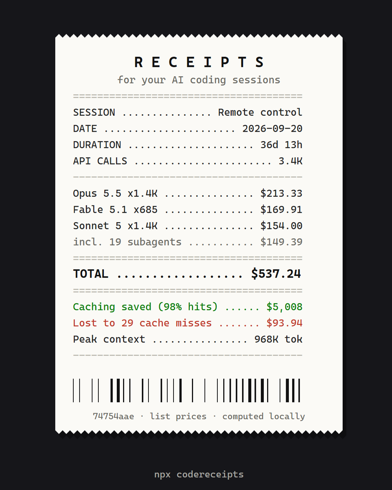

# Receipts

**Your AI coding sessions, itemized.** Receipts reads the transcripts Claude Code already keeps on your machine and tells you what each session really cost, where the tokens went, how much the prompt cache saved you, and how much you lost when it went cold. Then it helps you pay less, and proves it.

```bash
npx codereceipts
```

No account, no API key, no upload. Everything runs locally. Zero runtime dependencies.

<p align="center"></p>

## What it shows you that nothing else does

**1. Cache-miss forensics.** Every Claude Code turn re-sends the whole conversation. When the prompt cache is warm that is cheap; when it goes cold you pay to write it all again. Receipts finds every miss in a session, names the likely cause (long break, model switch, prompt or tools changed, compaction) and prices it:

```
Lost to cache misses .................. $93.94
  23x cache expired (long break) ...... $80.89
  3x prompt or tools changed .......... $13.05
  3x compaction (expected) ............. $0.00
```

**2. A live cache countdown.** The status line shows how long your cache stays warm and what the next turn costs if you let it expire:

```
$4.12 $6.20/h │ cache 94% warm 3:41 · cold costs $1.80 │ ctx 38% │ trimmed 42K tok
```

Step away for a coffee and you know exactly what it will cost you.

**3. A lossless output trimmer that proves its savings.** A `PostToolUse` hook shrinks noisy output from commands that succeed (test suites, installs, builds, logs, `git log`) before Claude reads it. Repeated and similar lines collapse; every error, warning and stack trace stays. The full output is saved to disk and the path is shown to Claude, so nothing is ever lost. Commands that only read (`cat`, `grep`, `git diff`, anything piped into them) are never touched.

A real passing `npm test` run with 401 tests: **3,605 tokens down to 104**.

Claude Code does not let hooks rewrite the output of a command that fails, so failures always reach Claude exactly as printed.

**4. Compounding savings, measured.** A token kept out of the context early is not re-read by any later turn. Receipts joins each trim with the turns that followed it and prices every cache read that never happened, up to the next compaction. No made-up "up to 90%" claims: the receipt shows the dollars for your session.

**5. Context X-ray.** `receipts report` opens a page with the context size call by call, every cache miss marked, the running cost, spend by model and subagent, and what filled the context (which tool, which file, how many times).

**6. A/B bench for any plugin.** Every Claude Code plugin claims to save tokens. `receipts bench` runs the same task with and without a plugin in throwaway local clones of your own repo (no remotes, so nothing can be pushed) and compares real cost, turns and whether your tests pass.

```bash
receipts bench --task "fix the failing test" --plugin ../some-plugin --check "npm test" --runs 3 --model haiku
```

## Install

Run it once, no install:

```bash
npx codereceipts
```

Add the live status line and the trimmer to Claude Code (backs up your settings first):

```bash
npx codereceipts install
```

Or install it as a Claude Code plugin (trimmer, `/codereceipts:receipt` skill and a cheap `scout` search agent):

```
/plugin marketplace add salman-moussa/codereceipts
/plugin install codereceipts@codereceipts
```

## Commands

| Command | What it does |
|---|---|
| `receipts` | Receipt for your latest session |
| `receipts <id>` | Receipt for one session (id prefix is enough) |
| `receipts list` | Recent sessions with their cost |
| `receipts week --days 7` | Spend across all projects, by day, project and model |
| `receipts report` | Open the Context X-ray page |
| `receipts card` | Save a shareable receipt card (SVG) |
| `receipts bench ...` | A/B test plugins on your own repo |
| `receipts install` / `uninstall` | Add or remove the status line and trimmer |
| `--json` | Raw numbers for scripts |

## How the numbers are computed

- **Cost** uses Anthropic list prices per model, with each call's four meters: fresh input, cache writes (1.25x input for the 5-minute cache, 2x for the 1-hour cache), cache reads (priced per model) and output. Fast mode is priced at 2x. Subagent transcripts are included.
- **Claude Code writes one line per content block**, so the same API call appears several times. Receipts counts each message id once.
- **A cache miss** is a call that read less than half of what the previous call had in context, on a context of at least 8K tokens. The cause is the first match of: compaction in between, a gap longer than the cache lifetime, a model change, otherwise a prompt or tool change. The cost is the extra paid to write those tokens instead of reading them.
- **Trim savings** count tokens only up to what Claude Code would really have shown (it cuts Bash output at 30,000 characters by default), and only for commands that succeeded.
- **Token estimates** for tool results use about 4 characters per token. Costs come from the exact token counts in the API usage data.

Your real bill can differ: subscription plans, discounts and gateways are not visible in transcripts. Receipts shows list-price value, which is what the work would cost on the API.

## Privacy

Receipts only reads files on your machine (`~/.claude/projects`) and writes to `~/.codereceipts`. It makes no network calls. The share card contains numbers and the session title, never code or file paths.

## Turning things off

- Trimmer off for one session: `CODERECEIPTS_TRIM=off claude`
- Remove everything: `npx codereceipts uninstall`, or uninstall the plugin.

## License

MIT
